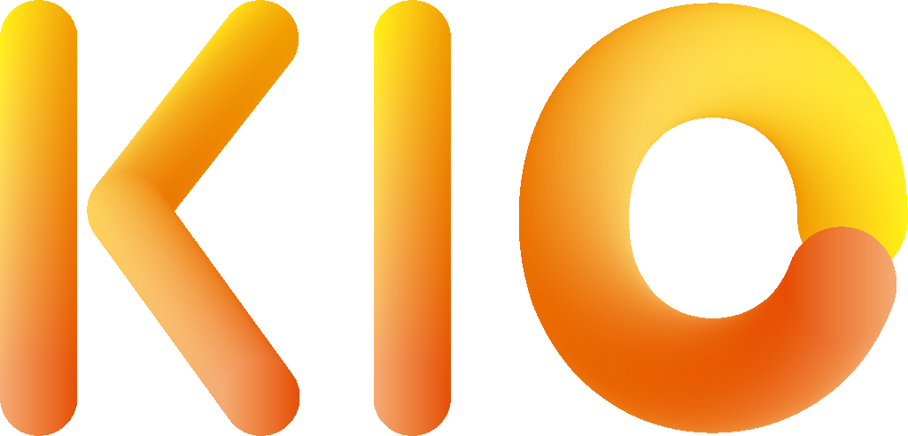
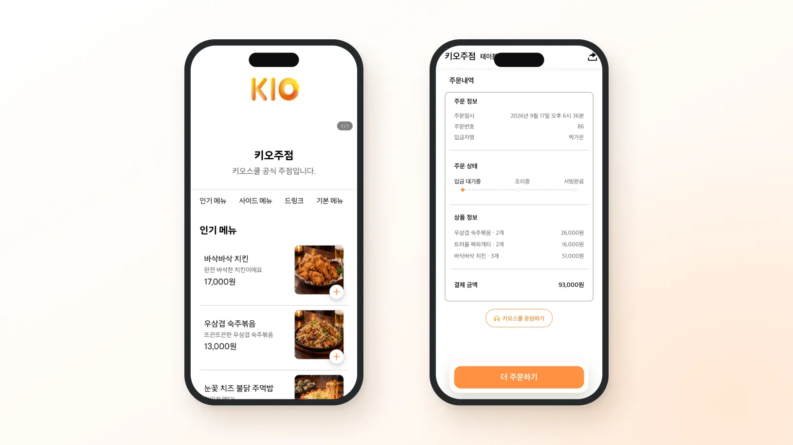
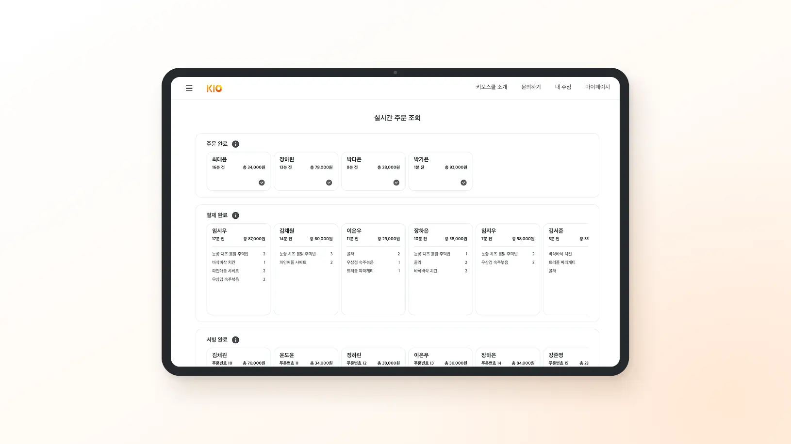

  

<h1 align="center">키오스쿨</h1>

  <strong>대학 축제 주점 운영을 위한 QR 주문 서비스</strong>

  
  
  

> 안녕하세요 👋 대학 축제 주점 운영의 불편함을 기술로 해결하는 **키오스쿨 팀**입니다.
>
> 수기 주문, 수동 정산, 부족한 인력으로 인해 축제를 준비한 학생들이 
> 정작 축제를 즐기지 못하는 문제에서 키오스쿨은 시작했습니다.
>
> 운영의 부담은 줄이고, 모두가 축제 본연의 즐거움에 집중할 수 있는 환경을 만들어갑니다.

## 🔗 바로가기

- 🌐 [키오스쿨 서비스](https://kio-school.com)
- 🍊 [서비스 소개](https://kio-school.com/info)
- 💬 [문의하기](https://kio-school.com/contact)
- 📸 [인스타그램](https://www.instagram.com/kioschool/)
- 🎥 [서비스 영상](https://www.youtube.com/watch?v=4tZjnj48hBk)
- 💻 [프론트엔드 저장소](https://github.com/KioSchool/KioSchool)
- ⚙️ [API 저장소](https://github.com/KioSchool/KioSchool-API)

## 🌍 키오스쿨은

키오스쿨은 대학 축제 주점 운영에 맞춰 설계된 QR 주문 서비스입니다.

손님은 테이블에 부착된 QR을 스캔해 별도의 앱 설치나 로그인 없이 메뉴를 확인하고 주문할 수 있습니다. 운영진은 PC와 태블릿에서 들어오는 주문을 실시간으로 확인하고, 입금 확인부터 조리와 서빙까지 주문 상태를 관리할 수 있습니다.

축제가 끝난 뒤에는 테이블별·메뉴별 주문과 매출을 확인할 수 있어 복잡했던 정산 과정도 간편하게 마무리할 수 있습니다.

## ✨ 서비스 화면

<table>
  <tr>
    <th width="33%">사용자</th>
    <th width="33%">관리자</th>
  </tr>
  <tr>
    <td align="center">
      
    </td>
    <td align="center">
      
    </td>
  </tr>
</table>

## 📱 핵심 기능

### QR 주문

- 테이블 QR을 스캔하면 주점의 메뉴판이 바로 열립니다
- 별도의 애플리케이션 설치나 회원가입이 필요하지 않습니다
- 메뉴 탐색부터 주문과 송금 안내까지 모바일에서 진행할 수 있습니다

### 실시간 주문 관리

- 새로운 주문을 운영진 화면에서 실시간으로 확인합니다
- 입금 대기, 조리, 서빙 완료 등 주문 상태를 단계별로 관리합니다
- 카운터와 주방이 떨어져 있어도 같은 주문 현황을 함께 확인할 수 있습니다

### 테이블 관리

- 테이블 수를 설정하면 주문용 QR이 자동으로 생성됩니다
- 테이블별 이용 시간과 누적 주문 금액을 확인합니다
- 주점 상황에 맞게 테이블 배치와 운영 상태를 관리합니다

### 정산과 통계

- 테이블별·메뉴별 주문과 매출을 자동으로 집계합니다
- 시간대별 매출과 주문 흐름을 확인합니다
- 축제가 끝난 뒤 수동으로 주문 내역을 다시 정리하는 부담을 줄입니다

## 💡 우리가 만드는 가치

- **별도 장비 없이 시작** — PC, 태블릿과 테이블 QR만 있으면 운영할 수 있습니다
- **손쉬운 도입** — 주점을 만들고 메뉴와 테이블을 등록하면 바로 사용할 수 있습니다
- **운영 인력 부담 감소** — 주문 접수와 전달에 필요한 반복 업무를 줄입니다
- **실시간 협업** — 카운터, 홀, 주방이 같은 주문 상태를 함께 확인합니다
- **무료 이용** — 별도의 구독료 없이 대학 축제 주점에 도입할 수 있습니다

## 🛠️ 기술 스택

### Frontend

### Backend

### Infrastructure & Monitoring

## 📦 저장소

| 저장소                                                      | 설명                                                                        | 주요 기술                              |
| ----------------------------------------------------------- | --------------------------------------------------------------------------- | -------------------------------------- |
| [KioSchool](https://github.com/KioSchool/KioSchool)         | 손님 주문 화면, 주점 운영진 화면, 서비스 관리 화면을 제공하는 웹 프론트엔드 | React, TypeScript, Vite                |
| [KioSchool-API](https://github.com/KioSchool/KioSchool-API) | 인증, 주문, 주점, 테이블, 통계 및 실시간 통신을 처리하는 API 서버           | Kotlin, Spring Boot, PostgreSQL, Redis |

## 👥 함께 만드는 사람들

<table>
  <tr>
    <td align="center">
      <a href="https://github.com/Ji-InPark">
        
         
        <strong>박지인</strong>
      </a>
    </td>
    <td align="center">
      <a href="https://github.com/zziglet">
        
         
        <strong>정지원</strong>
      </a>
    </td>
    <td align="center">
      <a href="https://github.com/whddltjdwhd">
        
         
        <strong>이성종</strong>
      </a>
    </td>
    <td align="center">
      <a href="https://github.com/seoa0">
        
         
        <strong>서아영</strong>
      </a>
    </td>
  </tr>
  <tr>
    <td align="center">Backend</td>
    <td align="center">Frontend</td>
    <td align="center">Frontend</td>
    <td align="center">Design</td>
  </tr>
</table>

## 📮 문의

서비스 도입이나 운영 중 문의가 있다면 편하게 연락해 주세요.

- 이메일: [kio4school@gmail.com](mailto:kio4school@gmail.com)
- 인스타그램: [@kioschool](https://www.instagram.com/kioschool/)
- 문의 페이지: [kio-school.com/contact](https://kio-school.com/contact)

 

  <strong>모든 대학 축제가 즐거운 경험이 되도록.</strong>
   
  키오스쿨은 축제를 준비하는 사람들의 운영 부담을 줄여갑니다.

